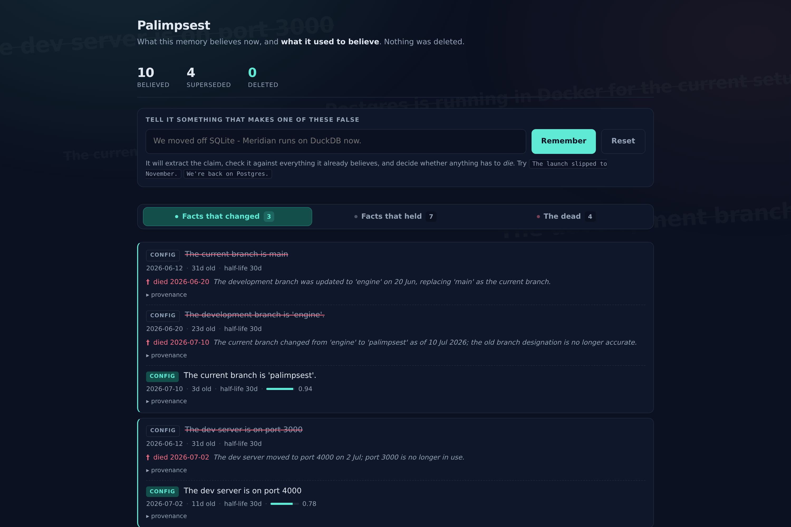
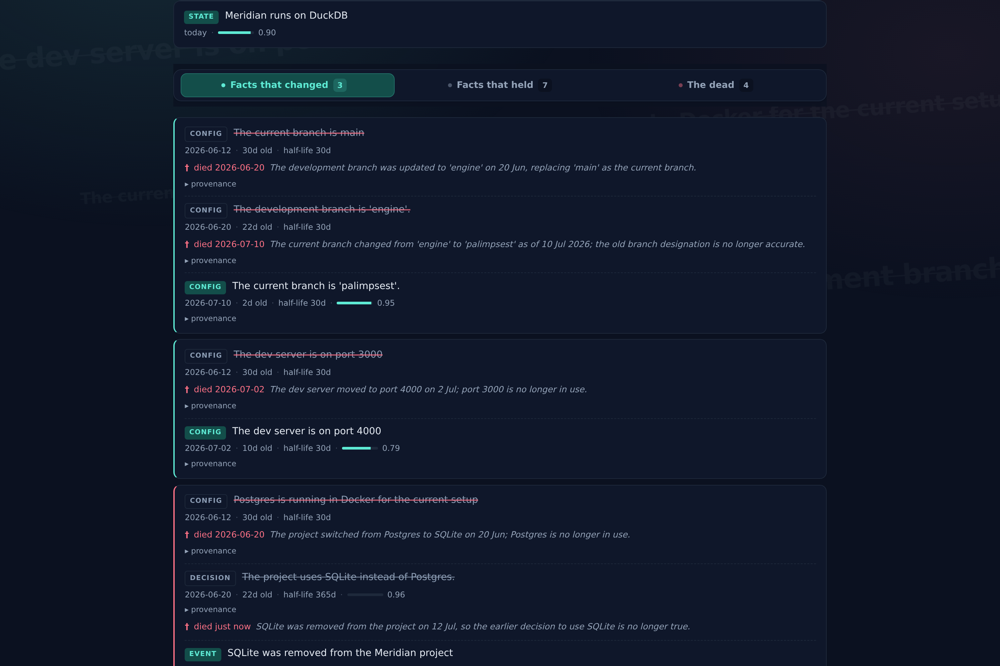
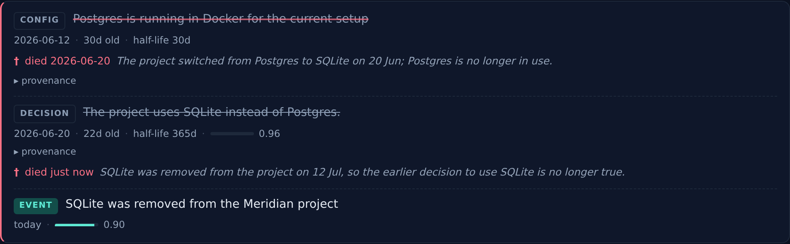

<div align="center">

# Palimpsest

**Agent memory that forgets.**<br>
When a fact changes, the old one dies - on record, with the date and the reason - so your agent stops repeating it.

[](#run-it) [](#use-it-as-your-memory-in-claude-code) [](LICENSE)

Free · Runs on your machine · No API key, no vector database · TypeScript + SQLite

<br>



</div>

<br>

## Why I built this

I kept a notes file for my coding agent, with a "current focus" line in it. One day I saw it still naming a branch I had left eight days earlier - and the agent read it out with total confidence. A line of text cannot notice it stopped being true. Every memory tool I tried had the same problem: it only adds, it never lets anything die.

Old is not the same as wrong, either. On 2026-08-14 two of my claims had both faded to the same confidence, 0.48. One recorded a Node version and was still exactly true. The other said a database port was open to the internet, and had been false for weeks. Same number, opposite truth.

So **Palimpsest** stores one small fact at a time, each with a kind and a half-life. When a new fact contradicts an old one, the old one dies and keeps a death note: when, what replaced it, and why. It began as my entry to a Qwen Cloud hackathon (tag [`qwen-submission`](../../tree/qwen-submission)); now it is the memory I use every day.

> *palimpsest (n.) - a page scraped clean and written over, where the old writing still shows through.*

## A quick look

<table>
<tr>
<td width="50%" valign="top"><br><b>Every change, with the reason the old fact died</b></td>
<td width="50%" valign="top"><br><b>Tell it something new, and the claim it contradicts dies on the spot</b></td>
</tr>
</table>

## Highlights

- ⚰️ **Facts can die**: a contradicting fact kills the old one. Nothing is deleted - `history` tells you what it used to believe and when it stopped.
- ⏳ **Each kind fades at its own speed**: a name lasts years, a config setting a month, a "right now" state a week. Events never fade - what happened, happened.
- 🔍 **Probes**: a claim can carry a read-only command that checks it against the real world. `verify` runs them when you ask.
- 🧰 **Seven MCP tools**: `remember`, `believe`, `history`, `assert`, `reaffirm`, `verify`, `forget`. Over stdio, or Streamable HTTP at `/mcp`.
- 🪝 **Recall hook**: every session opens with what the memory believes now, plus the claims too old to lean on.
- 🏠 **Local**: one SQLite file, one Node process, embeddings run on your machine. By default it uses the Claude Code login you already have - no key.
- 📊 **Benchmark you can replay**: every model call is cached in the repo, so you get the same numbers without spending anything.

<details>
<summary><b>Everything it does</b> (click to open)</summary>

### The tools

- `remember`: a note or transcript in, small atomic claims out. Each new claim is checked against what it might collide with, and the model rules: update, contradiction, refinement, or new.
- `believe`: what is true now. Dead claims are left out, not just ranked lower.
- `history`: what it used to believe, when it stopped, and why.
- `assert`: one fact, instantly, with no model call. `supersedes: [id]` kills what it replaces; `probe` + `expect` give it a check.
- `reaffirm`: a doubted claim is still true - its clock restarts.
- `verify`: run the probes. A pass means full trust for a day; a fail means zero - wrong, not old. A probe that could not run says so.
- `forget`: refute a claim directly, with a reason on record.

### Half-lives

| Kind | Half-life |
|---|---|
| `identity` | 3650 days |
| `preference` | 730 days |
| `decision` | 365 days |
| `config` | 30 days |
| `state` | 7 days |
| `event` | never fades |

### The web app (`pnpm serve`)

- `/` - the audit view: what it believes, what it used to believe, and the dead.
- `/alexa` - a household demo in a voice-assistant style. Ask a question, state a change, ask again; the old answer shows up struck through under the reply.
- `/mcp` - the same tools over Streamable HTTP.
- `/api/*` - the JSON the pages use.

### The benchmark

12 sessions of a made-up project over three months. Facts change: the database is swapped, the launch slips, the brand colour moves. Then both memories are asked what is true now. The baseline is plain RAG with the same extraction, embeddings and answering model - the only difference is that one of them can kill a claim. Recorded 2026-09-19 (v4):

| | plain RAG | Palimpsest |
|---|---|---|
| Facts that changed | 45% (5/11) | **100% (11/11)** |
| Facts that never changed | 88% (7/8) | 88% (7/8) |
| Overall | 63% (12/19) | **95% (18/19)** |
| Dead facts served | 3 | **0** |

Where it still fails, every version, and what fixed what: [`src/bench/RESULTS.md`](src/bench/RESULTS.md).

</details>

## Run it

You need Node 22 or newer and `pnpm`.

```bash
git clone https://github.com/joyahmed/palimpsest
cd palimpsest
pnpm install
touch .env                 # the scripts read .env; an empty one is fine
pnpm test                  # live end-to-end check on a scratch database
pnpm seed:household        # ten household facts for the /alexa demo
pnpm serve                 # http://localhost:9000  - audit view, /alexa, /mcp
```

Keep `.env` empty unless you mean to switch provider. By default chat runs through the `claude` command (`claude -p`), so it needs Claude Code installed and logged in. Setting `ANTHROPIC_API_KEY` switches it to the API instead.

Replay the benchmark from the committed cache - no key, no spend. A cache miss throws instead of quietly calling the model:

```bash
PALIMPSEST_CACHE_ONLY=1 pnpm bench
```

## Use it as your memory in Claude Code

**1. The MCP server**, for every project:

```bash
pnpm build
claude mcp add --scope user palimpsest \
  -e PALIMPSEST_DB=$HOME/.palimpsest/memory.db \
  -e PALIMPSEST_CACHE_DIR=$HOME/.palimpsest/cache \
  -e PALIMPSEST_PROVIDER=claude-code \
  -- "$(nvm which default)" "$PWD/build/mcp/server.js"
```

Use absolute paths: MCP servers and hooks start without your shell setup, so `node` from nvm is not on their PATH. `claude mcp get palimpsest` should say **Connected**.

**2. The recall hook**, in `~/.claude/settings.json`:

```json
{
  "hooks": {
    "SessionStart": [
      { "hooks": [ { "type": "command",
        "command": "PALIMPSEST_DB=$HOME/.palimpsest/memory.db /abs/path/to/node /abs/path/to/palimpsest/build/cli/recall.js" } ] }
    ]
  }
}
```

`pnpm recall` prints the same text for you to read. If the database cannot be read, the hook says so loudly instead of passing it off as an empty memory.

## Watch it

[Palimpsest - Agent Memory That Forgets](https://youtu.be/_E1ftpmVEHE) (2:41). More of what I build: [youtube.com/@joysbuilds](https://www.youtube.com/@joysbuilds).

## License

MIT. See [LICENSE](LICENSE).

---

<div align="center">

I build tools I use myself, from Bangladesh. If Palimpsest stops your agent from repeating a dead fact, that makes me happy.<br>
Found a bug or want something? [Open an issue](https://github.com/joyahmed/palimpsest/issues).

**Joy**

</div>
